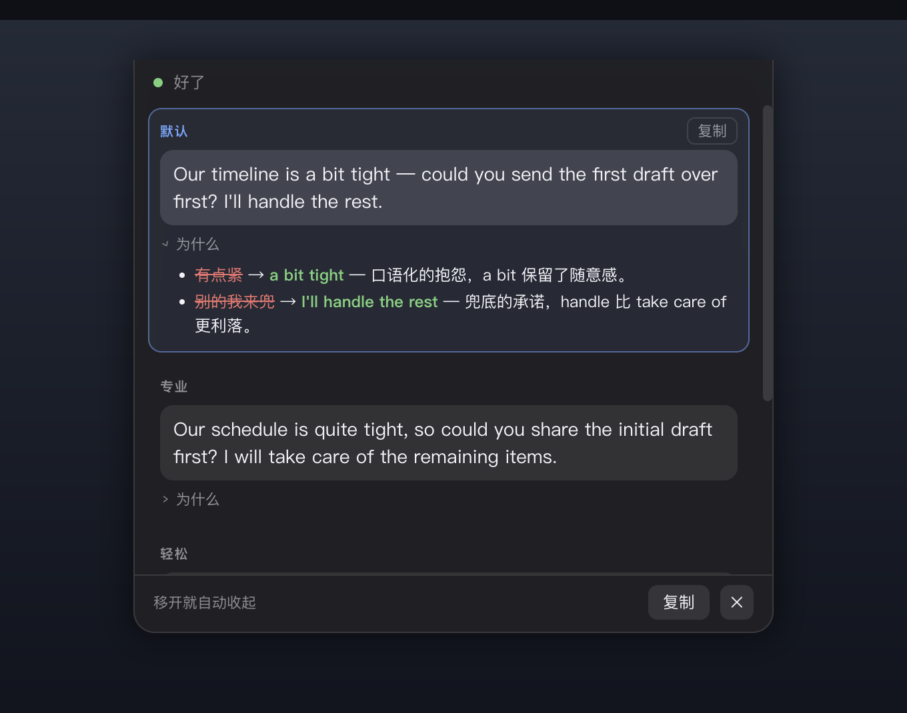

# SayBetter

<p align="center">
  
</p>

一个复制即触发的 macOS 表达助手：复制任意一句话，屏幕顶端立刻给出四种说法和每一处改动的理由。

[中文](#中文) · [English](#english) · [下载最新版](https://github.com/eSeaFiller/saybetter/releases/latest)



## 中文

### 为什么做 SayBetter

用不是母语的语言写东西，卡住的往往不是"不会说"，而是"不确定"。邮件写完了，句子也读得通，但你说不准它在对方眼里是礼貌还是生硬、是专业还是随便。母语者也一样：给客户的消息要不要再正式一点？这句话会不会显得太冲？

于是你打开浏览器，切到某个 AI 工具，登录，复制，粘贴，等它回答，再复制回来。这套动作本身只要二十秒，但它打断的是你正在写这句话的思路。更常见的结果是：你嫌麻烦，直接发了出去，然后在心里犯嘀咕。

SayBetter 想去掉的就是这二十秒。

它常驻在后台，监听你的剪贴板。你在任何地方选中文字按 `⌘C`，屏幕顶端刘海下方就会浮出一颗胶囊开始工作：

- 复制的是中文或任何非英文，它翻译成英文，并保留你原话的语气和正式程度——原文直白就保持直白，原文客气就保持客气。
- 复制的是英文，它检查语法、改得更地道。

结果不是一个答案，而是**四种**：默认、专业、轻松、简洁。每一种下面挂着一个可展开的"为什么"，用红绿对照告诉你改了哪个词、为什么这么改。你挑中哪一种就复制哪一种，切回原来的窗口 `⌘V`。

它不打断你。浮窗不抢焦点，你可以继续打字；不把鼠标移上去它就只是一颗安静的胶囊；移上去才展开。换到别的桌面、进了全屏应用，它都跟着你。

菜单栏里还有一颗绿点。手上已经复制好了内容、只是想再看一遍，点它就行。

### 功能

- 复制即触发，无需切换应用或按任何快捷键。
- 一次给出默认、专业、轻松、简洁四种表达，可分别复制。
- 每种表达附带可展开的修改说明，标出改动的词和原因。
- 非英文自动翻译为英文并保留原文语气；英文则做语法校对。
- 浮窗出现在你正在使用的那块屏幕顶端，跟随切换桌面（Space）与全屏应用，且不抢占键盘焦点。
- 鼠标停留约 1.2 秒才展开，只是路过不会被打断。
- 展开后四种语气固定在顶部，无需滚动即可切换；正文字号随长度自适应。
- 结果不逐字蹦出：顶部进度条走满 2 秒后一次性揭晓，每次节奏一致。
- 极光渐变与玻璃态：四条色带在玻璃后缓慢漂移（11–16 秒），前景是半透明玻璃卡片加高光描边，叠原生毛玻璃。
- 顶部保留极光、正文区压深，最坏情况（白色桌面 + 最亮色带）下所有文字仍满足 WCAG 对比度。
- 菜单栏常驻一颗绿点，点它即可用当前剪贴板内容触发一次；处理中会变成空心圈。
- 处理中和出结果后浮窗保持显示，不会自行消失。
- 可接入 Anthropic、DeepSeek、Kimi、通义千问、智谱、豆包/火山方舟、OpenAI、Ollama，以及任何 OpenAI 兼容网关。
- 自动关闭 DeepSeek、豆包、通义的思考模式，避免响应变慢。
- 界面支持中文、English、Tiếng Việt、Bahasa Indonesia、ไทย、Bahasa Melayu。
- 保留在程序坞，点击图标可随时唤出面板。
- 另有全局快捷键面板（默认 `⌥Space`）用于手动输入。

### 安装

1. 从 [Releases](https://github.com/eSeaFiller/saybetter/releases/latest) 下载 DMG。
2. 打开 DMG，把 `SayBetter.app` 拖入「应用程序」。
3. 当前版本尚未经过 Apple 公证，需要在「终端」执行一次以下命令解除隔离，否则会提示「已损坏」而无法打开：

   ```bash
   sudo xattr -r -d com.apple.quarantine /Applications/SayBetter.app
   ```

   回车后需要输入开机密码，输入时屏幕不显示字符属于正常现象。该命令只作用于 SayBetter，不改动任何系统设置。
4. 打开应用，点两次「下一步」进入设置页。
5. 填写服务商和 API Key（模型会自动带出推荐值），保存即可开始使用。

每次更新到新版本后，需要重复第 2、3 步；已有配置不会丢失。

### 系统要求

- macOS 13 或更高版本。
- Apple Silicon（M1/M2/M3/M4）。暂不提供 Intel 版本。
- 一个可用的模型 API Key；或在本机运行 Ollama，无需 Key。

### 隐私

- API Key 通过系统钥匙串加密后保存在本机 `~/Library/Application Support/SayBetter`。
- **开启「监听复制」后，你复制的内容会发送给你自己配置的那家模型服务商。** 复制密码、密钥等敏感内容前，请在设置中关闭该开关。
- 应用不上传任何数据到作者处，不含分析、遥测或远程服务。
- 少于 2 个字、超过 1200 字、纯网址、纯邮箱地址的内容会被自动跳过，不会发送。

### 常见问题

**双击提示「已损坏，无法打开」**：安装第 3 步没做，或更新覆盖后需要重新执行一次。

**复制了但没有弹出浮窗**：检查设置里「监听复制」是否开启；确认复制的内容没有落在上面「隐私」一节列出的跳过规则里；内容与上次完全相同也不会重复触发。

**很慢，或显示 Ready 但没有内容**：模型开启了思考模式，思维链耗尽了输出预算。应用已对 DeepSeek、豆包、通义自动关闭；若使用其他服务商仍然如此，请换用不带思考模式的模型。

### 作者与反馈

- Bug 反馈：[xujianghao02@gmail.com](mailto:xujianghao02@gmail.com)

## English

### Why SayBetter exists

When you write in a language that is not your own, what stops you is rarely "I don't know how to say this." It is "I am not sure." The email reads fine, the grammar holds up, but you cannot tell whether it lands as polite or blunt, professional or careless. Native speakers hit the same wall: should this message to a client be more formal? Does this sentence come across as pushy?

So you open a browser, switch to some AI tool, sign in, copy, paste, wait, and copy the answer back. The round trip takes twenty seconds, but what it costs you is the thought you were in the middle of. More often you skip it entirely, send the message, and keep wondering.

SayBetter exists to remove those twenty seconds.

It sits in the background watching your clipboard. Press `⌘C` anywhere and a pill drops down from the top of the screen and starts working:

- Copy Chinese, or any non-English text, and it translates into English while preserving your register — blunt stays blunt, warm stays warm.
- Copy English and it corrects the grammar and makes it sound natural.

You do not get one answer. You get **four**: Default, Professional, Casual, Concise. Each carries an expandable "Why" that shows, in red and green, which words changed and the reason. Pick the one you want, copy it, and paste it back where you were.

It stays out of your way. The pill never takes keyboard focus, so you can keep typing. Leave the pointer alone and it remains a quiet capsule; move onto it and it expands. Switch Spaces or enter a full-screen app and it follows you there.

There is also a green dot in the menu bar. If the text is already on your clipboard and you just want another look, click it.

### Features

- Triggered by copying. No app switching, no shortcut required.
- Four registers at once — Default, Professional, Casual, Concise — each individually copyable.
- Every version carries an expandable explanation naming the words that changed and why.
- Non-English input is translated into English with the original tone preserved; English input is proofread.
- The pill appears at the top of whichever display you are working on, follows you across Spaces and full-screen apps, and never steals keyboard focus.
- It expands only after the pointer rests on it for about 1.2 seconds, so merely passing by never interrupts you.
- The four registers stay pinned at the top — no scrolling needed to switch. Body text scales with length.
- Results are not streamed word by word: a two-second progress bar fills first, then everything appears at once, so the rhythm is the same every time.
- Aurora gradients behind glass: four colour bands drift slowly (11–16s) behind a translucent glass card with a highlight rim, on top of native macOS vibrancy.
- The aurora stays near the top while the body area is darkened, so every piece of text still clears WCAG contrast even in the worst case (white desktop under the brightest band).
- A green dot sits in the menu bar; click it to run on the current clipboard. It turns into a ring while working.
- Stays visible while working and after the result arrives; it does not disappear on its own.
- Works with Anthropic, DeepSeek, Kimi, Qwen, Zhipu, Doubao/Volcengine Ark, OpenAI, Ollama, and any OpenAI-compatible gateway.
- Automatically disables thinking mode on DeepSeek, Doubao, and Qwen to keep responses fast.
- Interface available in Chinese, English, Vietnamese, Indonesian, Thai, and Malay.
- Remains in the Dock; click the icon to reopen the panel.
- A global shortcut panel (`⌥Space` by default) is available for manual input.

### Installation

1. Download the DMG from [Releases](https://github.com/eSeaFiller/saybetter/releases/latest).
2. Open the DMG and drag `SayBetter.app` into `Applications`.
3. This build is not Apple-notarized. Run the following once in Terminal to lift the quarantine flag, otherwise macOS reports the app as damaged and refuses to open it:

   ```bash
   sudo xattr -r -d com.apple.quarantine /Applications/SayBetter.app
   ```

   You will be asked for your login password. No characters appear while typing it; this is normal. The command affects only SayBetter and changes no system settings.
4. Open the app and click **Next** twice to reach Settings.
5. Enter a provider and API Key (the model field is filled in for you) and save.

Repeat steps 2 and 3 after each update. Your settings are preserved.

### Requirements

- macOS 13 or later.
- Apple Silicon (M1/M2/M3/M4). No Intel build is provided.
- An API key for a model provider, or Ollama running locally with no key required.

### Privacy

- The API key is encrypted with the system keychain and stored locally in `~/Library/Application Support/SayBetter`.
- **With clipboard watching enabled, everything you copy is sent to the model provider you configured.** Turn the switch off in Settings before copying passwords or secrets.
- The app uploads nothing to the author and contains no analytics, telemetry, or remote service.
- Text shorter than 2 characters, longer than 1200 characters, or consisting solely of a URL or an email address is skipped and never sent.

### Troubleshooting

**"App is damaged and can't be opened"**: step 3 of the installation was skipped, or needs to be repeated after an update.

**Nothing appears after copying**: check that clipboard watching is enabled in Settings, and that the text is not covered by the skip rules listed under Privacy. Copying identical text twice does not re-trigger.

**Slow, or "Ready" with no content**: the model is in thinking mode and the reasoning chain consumed the output budget. This is disabled automatically for DeepSeek, Doubao, and Qwen; with other providers, switch to a model without thinking mode.

### Author and feedback

- Bug reports: [xujianghao02@gmail.com](mailto:xujianghao02@gmail.com)

## 从源码构建

需要 Node.js 18 或更高版本。

```bash
npm install
npm start          # 本地运行
npm run dist       # 打包出 dmg
```

### 发版

```bash
scripts/release.sh 0.2.9 "这一版改了什么"
```

脚本会写版本号、自检打包白名单是否漏文件、卸载残留的 dmg 卷、打包、用真实下载地址重写 `latest.json`、提交推送、建 Release，最后实测一次更新检查确认能查到这一版。

### 项目结构

- `main.js` — 主进程：剪贴板监听、浮窗与面板的窗口管理、全局快捷键、配置读写
- `providers.js` — 模型层：服务商预设、两种协议的流式请求、提示词
- `updater.js` — 更新检查
- `preload.js` / `preload-pill.js` — IPC 桥
- `renderer/` — 面板与浮窗界面

### 更新机制

每 6 小时、以及启动后 8 秒，静默查一次仓库里的 `latest.json`。

依次尝试三条路径，任何一条成功即返回：

1. `/releases/latest` 的 302 重定向目标里带版本号。不限流、不缓存，发版后立刻可见，是主路径。
2. 仓库里的 `latest.json`，能带上更新说明。`raw.githubusercontent.com` 按路径缓存 300 秒（加查询串也绕不开），因此可能比实际版本慢几分钟，只适合当兜底。
3. GitHub API。匿名请求限 60 次/小时且按出口 IP 计，公司网络下几百人共用一个出口 IP，额度常年被占满（实测直接返回 403），所以放在最后。

未采用静默自动更新的原因：macOS 上 electron-updater 依赖 Squirrel.Mac 校验代码签名，而本应用目前为 adhoc 签名（无 Apple Developer ID）。adhoc 签名的包无法装上更新，这是系统机制而非配置问题。取得证书后将 `updater.js` 替换为 electron-updater 即可，其余代码无需改动。

### 思考模式

DeepSeek v4 系列、豆包、通义默认开启思考模式，思维链会占用输出预算，严重时正文为空、响应缓慢。应用对这三家自动下发关闭参数（DeepSeek 与方舟为 `thinking: {"type": "disabled"}`，通义为 `enable_thinking: false`），其余服务商不下发，以免不支持该参数的接口返回 400。
